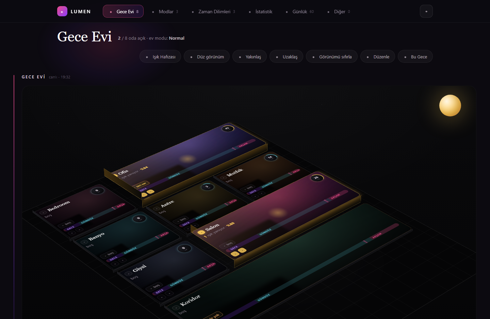
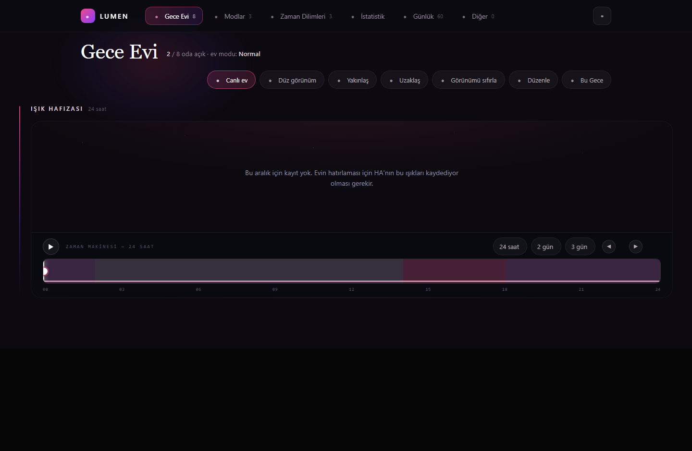
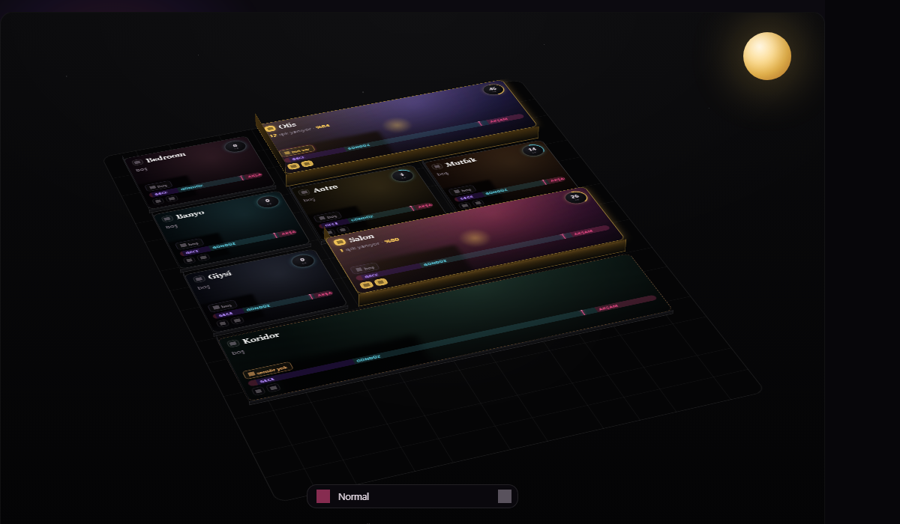

<p align="center"></p>
<h1 align="center">Lumen HA</h1>
<p align="center">Kendi kararını veren oda aydınlatması — ve neden öyle karar verdiğini söyleyen.<br>
Zamanlayıcı değil, blueprint değil: tek panel, tek motor, helper yok, YAML otomasyonu yok.</p>

<p align="center">
  <a href="https://github.com/hacs/integration"></a>
  
  
</p>

<p align="center"><a href="README.md">English</a></p>

---

<p align="center">
  
</p>

## Nedir?

Lumen HA her odanın ışığını senin yapacağın gibi çevirir: odanın sensörlerine
bakar, ortamın gerçekten ne kadar karanlık olduğunu görür ve karar verir. Her
karar düz bir cümleyle yazılır; ışık beklemediğin bir şey yaptığında tahmin
etmek yerine gerekçesini okursun.

Bütün yapılandırma tek bir panelde durur. Panel JSON yazar, motor onu okur.
Entity listende `input_boolean` helper'ları belirmez, arkandan otomasyon
üretilmez, YAML dosyalarına hiçbir şey yazılmaz.

## Neler var

**Ev, çizilmiş hâliyle** — her oda, çevirebildiğin, yakınlaştırabildiğin ve
yerini değiştirebildiğin izometrik bir planda bir kart. Yanan oda ışıldar,
boş oda ışıldamaz. Kartın üstünde odanın kendi ışık eğrisi, sensörleri ve bir
sonraki kararı durur.

**Kurallar odanın değil, saatin** — sabah, gündüz, akşam, gece ve eklediğin her
dilim. Her dilimin kendi cevabı vardır: açılsın mı, hangi ışıklar, ne parlaklıkta,
hangi sensör odayı uyandırır, hangisi uyanık tutar, boşaldıktan ne kadar sonra
sönsün ve ne kadar karanlık olması gerekir.

**İki tür sensör** — *uyandıran* ışığı açabilir; *tutan* yalnız sönmeyi
erteleyebilir. Kapının yanındaki hızlı PIR ile koltuğun üstündeki mmWave varlık
sensörü aynı işi yapmaz; ikisini ayırmak, sen kıpırdamadan otururken ışığın
ölmesini engelleyen şeydir.

**Bir kez karar verir** — ışık yandığı anda lux değeri dondurulur; odanın kendi
lambaları kendi ışık sensörüyle tartışamaz.

**Boşalan oda bir kez söner** — ışığı kim açmış olursa olsun. Bir şey ışığı
geri açarsa Lumen onunla güreşmez; senin seçtiğin dakikadan sonra durumu sana
söyler.

**Işık Hafızası** — son 24 saat, 2 gün ya da 3 gün üzerinde bir zaman makinesi.
Çubuğu sürükle, ev o dakikaya dönsün: hangi odalar yanıyordu, ne kadar, kim
neredeydi.

**Ev modları** — Normal ve Tek Oda kurulumla gelir; gerisini sen eklersin
(misafir, sinema, tatil — evin ne istiyorsa). Mod kuralların yerine geçmez,
onları büker.

**Kendini anlatır** — çevrimdışı kalan ya da susan cihazlar için sağlık sayfası,
saat/kWh sayfası ve her çevirmenin tek satır düz cümleyle yazıldığı bir günlük.

**İki dilli** — panelin tamamı Türkçe ve İngilizce.

## Işık hafızası

Evin iki günü, tek bir şeritte. Sürükledikçe odalar o an nasıl yandıysa öyle
yanar; "koridor gece üçte neden açıktı" sorusunu hatırlayarak değil bakarak
cevaplarsın.

<p align="center">
  
</p>

## Panoda

Aynı ev, bir Lovelace kartı olarak — `custom:lumen-house-card`. Kendini
kaydeder; elle eklenecek bir kaynak yok.

```yaml
type: custom:lumen-house-card
height: 620
turn: -20        # ev hangi yöne baksın
align: true      # ortalanmış başlasın, panelde çevirdiğin açıya bakmasın
walk: true       # cihazda animasyonlar kapalı olsa da figür yürüsün
interactive: false   # ekran koruyucu: bakılır, dokunulmaz
```

<p align="center">
  
</p>

## Kurulum

### HACS (özel depo)

1. HACS → Integrations → ⋮ → **Custom repositories**
2. Adres: `https://github.com/berkansezer77/lumen-ha`, kategori **Integration**
3. Kur, sonra Home Assistant'ı yeniden başlat
4. Ayarlar → Cihazlar ve servisler → **Entegrasyon ekle** → *Lumen HA*

### Elle

`custom_components/lumen_ha` klasörünü `config/custom_components/` içine kopyala,
yeniden başlat, sonra entegrasyonu ekle.

## Gereksinimler

- Home Assistant 2024.11 ya da üstü
- Işıklar veya anahtarlar (`light.*`, `switch.*`)
- Otomatikleştirmek istediğin her odada en az bir hareket ya da varlık sensörü
- İsteğe bağlı: oda başına bir aydınlık sensörü — yoksa oda yalnız harekete
  bakarak karar verir

## Nasıl çalışır

| | |
|---|---|
| **Uyandıran / tutan** | Uyandıran ışığı açabilir. Tutan yalnız geri sayımı erteleyebilir. Bir sensör ikisi birden olabilir. |
| **Mutabakat** | İki uyandıran varsa, *herhangi biri* ya da bir zaman aralığında *hepsi* istenebilir; koridor gelip geçen bir gölgeyle aydınlanmasın. |
| **Donmuş lux** | Eşik bir kez okunur: ışık yandığı anda. |
| **Karanlık gözcüsü** | Kararan bir odada kıpırdamadan otururken oda kendi kendini aydınlatabilir; ne sıklıkta bakacağını sen seçersin. |
| **Tek teklif** | Oda boşalınca Lumen ışığı bir kez söndürür. Sonrasında izler ve bildirir. |
| **Sigorta** | Kısa sürede fazla kez çalıştırılan bir oda beş dakika beklemeye alınır ve sebebi yazılır. |

## Notlar

Yüklediğin oda fotoğrafları `config/www/lumen/` altında saklanır. Home Assistant
bu klasörü `/local/…` adresinden **kimlik doğrulamadan** sunar; yüklediğin her
şeyi, Home Assistant adresine erişebilen herkese açık kabul et.

## Belgeler

[Wiki](https://github.com/berkansezer77/lumen-ha/wiki) sayfasına bak.

## Katkı

Sorun bildirimleri ve pull request'ler beklenir. `tests/` altında 66 test var —
28'i motor, 38'i panel — ve her push'ta CI'da koşuyorlar. Lütfen yeşil kalsınlar;
nasıl çalıştırıldıkları `tests/README.md` içinde yazıyor.

## Lisans

MIT © Berkan Sezer
